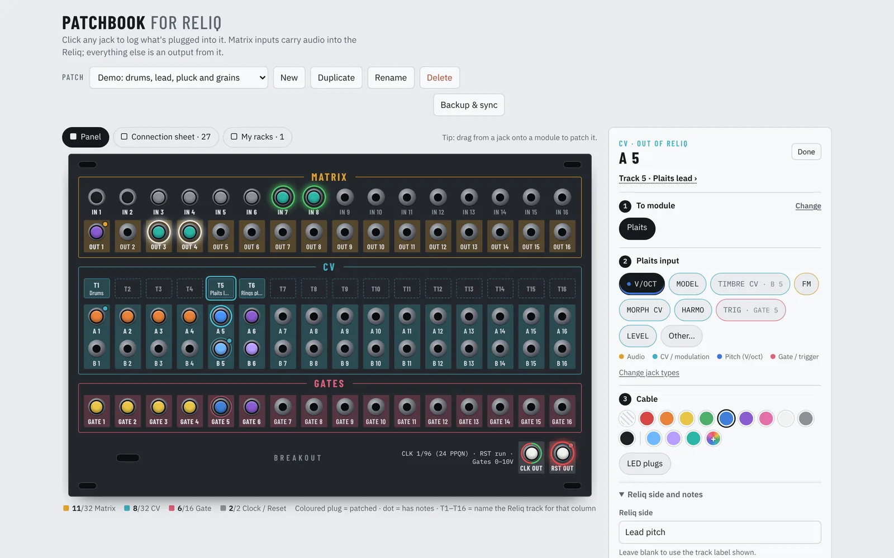
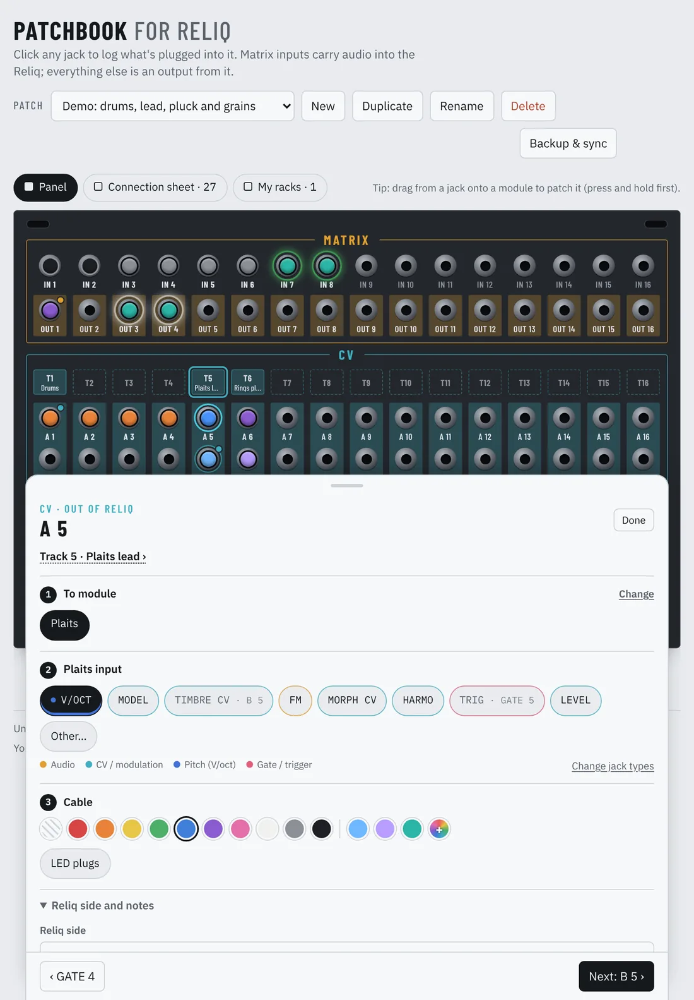
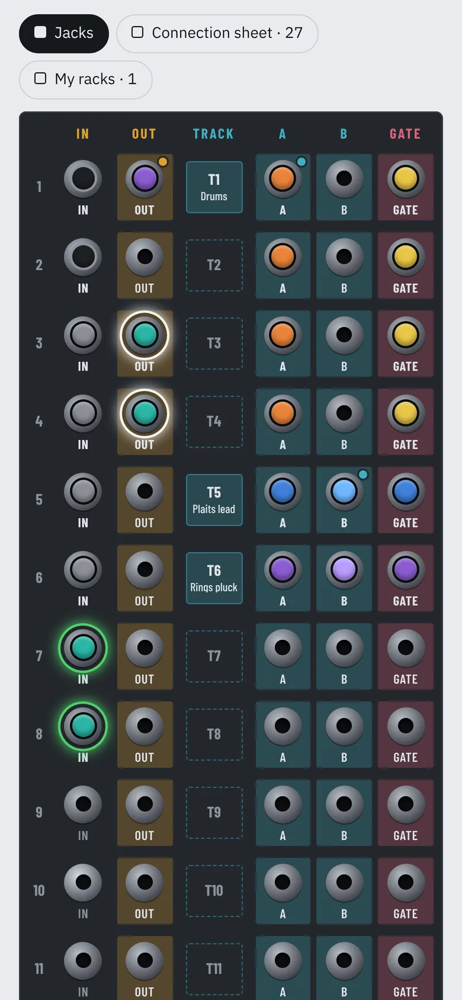
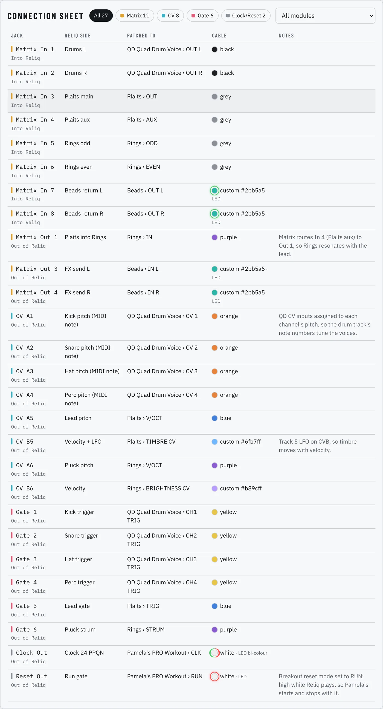
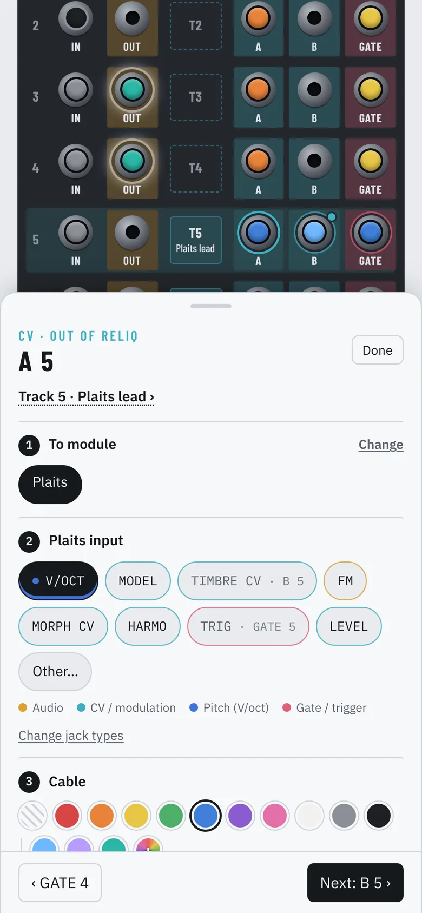
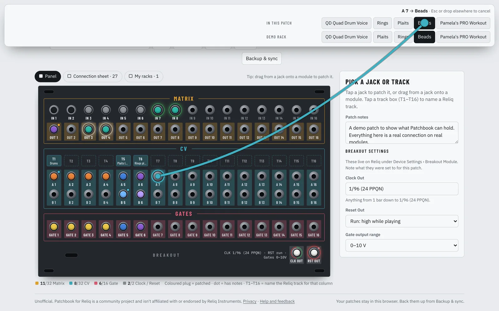
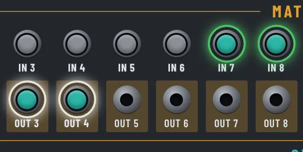
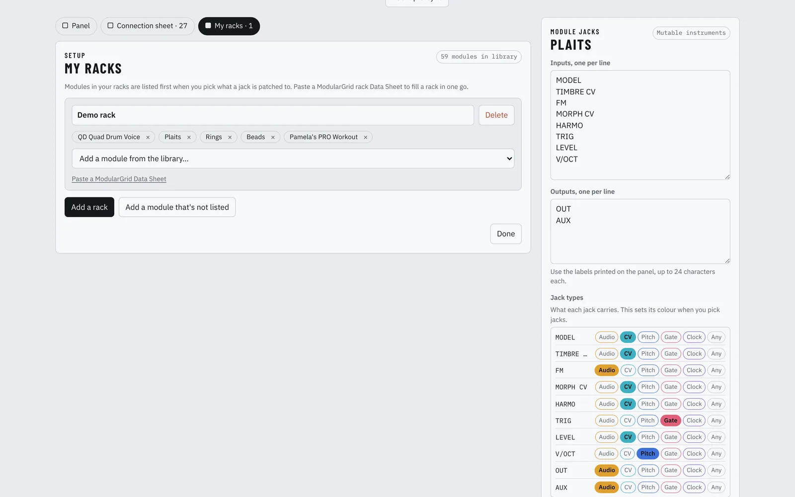
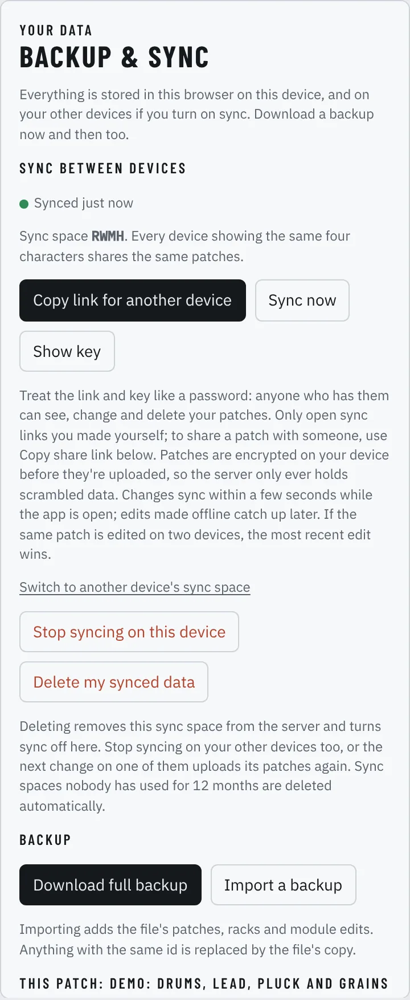

# Patchbook for Reliq

An unofficial patch notebook for the **Reliq Breakout Module**. Tap any jack on a redrawn faceplate and record what's plugged into it: the Reliq track behind it, the module and jack at the other end, the cable and any notes. Patchbook works offline, fits a phone, an iPad or a computer, and can keep all your devices in sync.

**Open it:** [patchbook-for-reliq.vercel.app](https://patchbook-for-reliq.vercel.app)

<picture>
  <source media="(prefers-color-scheme: dark)" srcset="docs/images/desktop-patching-dark.webp">
  
</picture>

> Patchbook for Reliq is a community project. It isn't affiliated with or endorsed by Reliq Instruments. "Reliq" is their trademark.

## Contents

- [Quick start](#quick-start)
- [The screen](#the-screen)
- [Patching a jack](#patching-a-jack)
- [Dragging a cable](#dragging-a-cable)
- [Tracks](#tracks)
- [Breakout settings](#breakout-settings)
- [Cables: colours and LED plugs](#cables-colours-and-led-plugs)
- [Jack colours (signal types)](#jack-colours-signal-types)
- [My racks and modules](#my-racks-and-modules)
- [Patches](#patches)
- [Backup and share](#backup-and-share)
- [Sync between devices](#sync-between-devices)
- [Install it as an app](#install-it-as-an-app)
- [Troubleshooting](#troubleshooting)
- [Privacy](#privacy)
- [For developers](#for-developers)
- [Reference](#reference)
- [Licence](#licence)

## Quick start

1. **Open Patchbook** and tap **Start a patch**. If you already use Patchbook on another device, paste its sync link into the box on the welcome screen instead (see [Sync between devices](#sync-between-devices)).
2. **Add your racks** (optional, but worth it): turn on **My racks**, add a rack and paste its ModularGrid Data Sheet. Your modules are then offered first whenever you patch a jack.
3. **Tap a jack** on the panel, pick the module it goes to, then the jack on that module, then the cable colour.
4. **Tap Next** to move on to the next jack. For CV and gates, Next goes a voice at a time: A, B, then Gate.
5. **Name your tracks** with the T1–T16 boxes, so A*n*, B*n* and Gate *n* are labelled with what the Reliq is sending.

Everything saves as you go. There's no save button.

**Want to look around first?** Tap **Try the demo patch** on the welcome screen. (Or download the [demo patch](docs/demo-backup.json) and use **Backup & sync → Import a backup**.) It's a small but real setup: a QD Quad Drum Voice on a custom-routed drum track, Plaits and Rings on CV tracks, Beads as a stereo send and return through the Matrix, and Pamela's PRO Workout on the clock. The screenshots in this README use it.

## The screen

Three views sit at the top of the main area. Each is an on/off toggle, so you can show any combination. Your choice is remembered on each device.

| View | What it shows |
|---|---|
| **Panel** (called **Jacks** on phones) | The Breakout Module faceplate. Matrix IN 1–16 over OUT 1–16, the T1–T16 track boxes, CV A/B 1–16, Gates 1–16, and CLK OUT and RST OUT. |
| **Connection sheet** | Every patched jack as a table, with zone and module filters. Tap a row to open that jack. |
| **My racks** | Your racks and their modules. See [My racks and modules](#my-racks-and-modules). |

**On the panel:**
- A coloured plug means the jack is patched, in the cable's colour.
- A small dot means the jack has notes.
- A glowing ring means an LED cable.
- When a jack or track is selected, the other jacks in the same track are outlined.

**Matrix inputs** carry audio *into* the Reliq. **Every other jack** is an output *from* the Reliq.

**The layout adapts to your screen:**
- **Computers and iPad landscape:** the panel scales to fit, with the editor docked beside it.
- **iPad portrait:** the panel fills the width, and the editor slides up from the bottom. The jack you tapped stays visible above the editor.
- **Phones:** the panel becomes one row per channel: Matrix IN and OUT, then the track box, then A, B and Gate. Sixteen columns can't fit a phone at a size you can tap, and this keeps each track next to the three jacks it drives.

**The side panel** (or bottom sheet) shows whatever you're working on: a jack, a track, a module, Backup & sync, or, when nothing is selected, the patch notes and Breakout settings.

<p>
<picture>
  <source media="(prefers-color-scheme: dark)" srcset="docs/images/ipad-portrait-dark.webp">
  
</picture>
&nbsp;
<picture>
  <source media="(prefers-color-scheme: dark)" srcset="docs/images/phone-rows-dark.webp">
  
</picture>
</p>

<picture>
  <source media="(prefers-color-scheme: dark)" srcset="docs/images/connection-sheet-dark.webp">
  
</picture>

## Patching a jack

Tap a jack and the editor opens with three steps.

**1. Module.** Pick what the cable goes to (or comes from, for Matrix inputs).
- **In this patch** lists every module already used in the patch. The module on the jack you've just come from (via Next), and the module set on this jack's track, are listed first.
- Below that, there's a tab for each of your racks, with its modules.
- **Search all modules** finds any module in the library. It ignores case and accents, so `lubadh` finds Lúbadh. Press Enter to pick the first result.
- **It's not a module in the library** lets you describe the other end in your own words instead, such as "Mixer channel 3".

**2. Jack.** Pick the jack on that module.
- Matrix In jacks list the module's **outputs**. Every other Breakout jack lists the module's **inputs**.
- **Likely matches come first**, marked with a dot: V/OCT for an A jack, TRIG or GATE for a gate, OUT for a Matrix input, and so on.
- **Jacks already used elsewhere in this patch** show where, for example `V/OCT · A 5`.
- Jacks are coloured by signal type. See [Jack colours](#jack-colours-signal-types).
- **Other…** lets you type a jack name. Anything you type is added to that module's jack list for next time.

**3. Cable.** Pick a colour, or a custom colour, and turn on LED plugs if it's an LED cable. See [Cables](#cables-colours-and-led-plugs).

**Reliq side and notes** (folded by default):
- **Reliq side** says what the Reliq is doing on this jack. For CV and gates it defaults to the track label, such as "Track 5 Plaits · pitch".
- **Notes** is free text: attenuation, range, Reliq settings, or why the cable is there.

**Unpatch jack** clears the jack after asking you to confirm.

<picture>
  <source media="(prefers-color-scheme: dark)" srcset="docs/images/phone-patching-dark.webp">
  
</picture>

**Moving between jacks:**

| Action | Button | Keyboard |
|---|---|---|
| Next jack | **Next: B 5 ›** | `]` |
| Previous jack | **‹ A 5** | `[` |
| Close the editor | **Done** | `Esc` |

**Next follows this order:**
1. Matrix In 1–16.
2. Matrix Out 1–16.
3. A 1 → B 1 → Gate 1 → A 2 → … → Gate 16, so you can patch a whole voice in one pass.
4. CLK OUT, then RST OUT.

## Dragging a cable

On an iPad or a computer (the screen must be at least 700 px wide), you can drag a cable straight out of a jack:

- **Mouse or trackpad:** press on a jack and drag.
- **Touch:** press and hold a jack for a moment, then drag. A quick swipe still scrolls the page as normal.

A tray of modules appears on the side of the screen away from the jack, with **In this patch** first, then each of your racks. A cable follows your finger, and the target you're over is highlighted.

**What happens when you drop it:**
- **On a module in the tray**, or on a module button in the open jack editor: the jack is patched to that module, and the editor opens at step 2 so you can pick the jack.
- **On a jack button in the open jack editor**: the module and the jack are set in one go. This only works for a cable going the same direction, so a Matrix In cable can't land on a list of inputs.
- **Anywhere else**, or if you press `Esc`: the drag is cancelled.

<picture>
  <source media="(prefers-color-scheme: dark)" srcset="docs/images/desktop-drag-dark.webp">
  
</picture>

## Tracks

A Reliq sequencer track set to CV output drives three Breakout jacks: **A *n*** carries pitch, **B *n*** velocity or modulation, and **Gate *n*** the gate (Reliq manual, p. 94). Tap a track box (T1–T16) to:

- **Name the track.** The name labels A*n*, B*n* and Gate *n* everywhere.
- **Note its CV/Gate standard:** 1 V/oct, 1.2 V/oct or Hz/V, normal or inverted (manual p. 95).
- **Mark custom output routing.** Tick this if the track's voices or drum sounds go to other CV and Gate jacks. A*n*, B*n* and Gate *n* then stop being labelled as this track.
- **Set its voice module.** **Patch A*n*, B*n* and Gate *n* to it** then fills in all three jacks with that module, guessing V/OCT and TRIG/GATE where there's a single match.
- **Jump straight to any of its three jacks.**

## Breakout settings

With nothing selected, the side panel shows the patch notes and the Breakout settings for this patch (manual p. 388). You can also reach them from **Breakout settings ›** on the panel:

- **Clock Out:** the division, from 1 bar down to 1/96 (24 PPQN).
- **Reset Out:** pulse at the start of playback, high while playing, or trigger on stop.
- **Gate output range:** 0–10 V or 0–5 V.

These settings live on the Reliq under Device Settings › Breakout Module. Patchbook just records what they were set to for each patch.

## Cables: colours and LED plugs

**Colours:**
- Ten standard colours are always available.
- The rainbow **+** opens a colour picker for any colour.
- Custom colours you've already used in your patches appear as extra swatches after the standard ones. They're collected from your patches, so they're the same on every synced device.

**LED plugs:** turn this on for cables with LEDs in the plugs (such as Synth Cables LED cables or OXI GLOWS). Then choose the LED:
- a **glow colour**: green, blue, red, orange, white, purple, or custom
- or **bi-colour**, a split green and red ring for the two-colour LEDs that show signal polarity.

The cable colour (the plug) and the LED colour (the ring) are set separately, so a white LED cable looks like a white plug with a glowing ring.

**Where LED cables show:**
- the panel, as a glowing ring around the plug
- the connection sheet, as a ring around the cable dot plus an "LED" label
- the cable you're dragging
- **Copy as text**, for example "white, LED: bi-colour"

The glow stops pulsing if your device has reduced motion turned on.

<picture>
  <source media="(prefers-color-scheme: dark)" srcset="docs/images/led-cables-dark.webp">
  
</picture>

## Jack colours (signal types)

Jack buttons in the editor are coloured by what the jack carries, matching the panel's colours where they can:

| Colour | Type | Typical jacks |
|---|---|---|
| Amber | Audio | OUT, IN L/R, FM |
| Teal | CV / modulation | TIMBRE CV, LFO, envelope out |
| Blue | Pitch (V/oct) | V/OCT, PITCH |
| Pink | Gate / trigger | TRIG, GATE, STRUM |
| Purple | Clock / reset | CLOCK, RESET, RUN |
| Plain | Any / depends | Interface I/O (ES-9), multi-purpose utilities, algorithm-dependent jacks (Disting) |

A small key under the jack buttons lists the types that module has. The dashed outlines on drop targets while you drag a cable use the same colours.

Every module in the library records the type of each jack. For jacks it doesn't know, such as jacks you've added or custom modules, Patchbook guesses from the name.

**To change a jack's type:** tap **Change jack types** next to the key in the jack editor (or open the module from My racks). Then tap a type for each jack and save. Only your changes from the library are stored, so library updates still reach the jacks you haven't changed. Your changes sync across devices, and **Reset to library version** undoes them.

<picture>
  <source media="(prefers-color-scheme: dark)" srcset="docs/images/racks-and-jack-types-dark.webp">
  
</picture>

## My racks and modules

Turn on **My racks** to manage the racks your modules live in. Modules in your racks are offered first when you patch a jack, and they fill the drag tray.

**Racks:**
- **Add a rack**, then rename it by editing its name.
- **Paste a ModularGrid Data Sheet** to fill a rack in one go. On ModularGrid, open your rack, choose Data Sheet, copy the module list, and paste it. Patchbook matches the modules it knows and lets you tick which to add.
- **Add a module from the library** with the dropdown under each rack.
- Remove a module with its **×**. Tap a module's name to edit its jack list.
- **Delete** removes the rack, but not the patches that use its modules.

**Modules:**
- **Edit a module's jacks:** inputs and outputs, one per line, plus the jack type for each.
- **Add a module that's not listed:** give it a name, maker, width and its jacks. It's stored on your devices, and sync carries it to the others.
- **Learned jacks:** anything you type under **Other…** while patching is added to that module.
- **Reset to library version** discards your edits to a library module.
- **Copy as library JSON** gives you your edited or custom module in the library's format, ready to share with other Reliq users. See [CONTRIBUTING.md](CONTRIBUTING.md).

The library currently covers 59 modules and 652 jacks. Each module lists where its jack names came from, and a confidence level. If a jack list isn't confirmed against the panel yet, the editor says so.

## Patches

The patch bar at the top holds:
- **Patch:** switch between patches.
- **New:** start an empty patch.
- **Duplicate:** copy the current patch, which is handy for variations.
- **Rename** and **Delete** (Delete asks first).

The status next to the buttons shows when your changes are saved. **Patch notes** (with nothing selected) are for the patch as a whole: tempo, the Reliq project name, or what the patch is for.

## Backup and share

Open **Backup & sync** from the header.

| Action | What it does |
|---|---|
| **Download full backup** | A `.json` file with all your patches, racks and module edits. Worth doing now and then, even with sync on. |
| **Import a backup** | Merges a backup file in. Anything with the same id is replaced by the file's copy. |
| **Copy share link** | A link that carries the whole current patch inside the link itself, plus any custom modules it uses. Nothing is uploaded. Anyone who opens it can add a copy to their own Patchbook. |
| **Download patch file** | The current patch on its own, as a file. |
| **Copy as text** | The patch as readable text, for notes, forums or messages. |

## Sync between devices

Sync keeps your patches, racks and module edits the same on your phone, iPad and computers. There's no account: a private **sync key** links your devices.

**Setting it up:**
1. On the device that has your patches, open **Backup & sync** and tap **Turn on sync**.
2. Tap **Copy link for another device**, and send the link to yourself.
3. On each other device, open the link and tap **Sync this device**. Or paste the link into the join box: it's on the welcome screen of an empty device, or under Backup & sync → Join another device. The **Paste** button reads it straight from the clipboard.

Joining merges what's already on that device with the synced patches. Nothing is thrown away.

**Day to day:**
- **When changes arrive:** your changes reach the server a second or two after you make them. Other devices pick them up within a minute, or straight away when you switch back to the app.
- **Working offline:** edits wait on the device and catch up when you're back online. The status line says when it last synced.
- **Conflicts:** if the same patch is edited on two devices, the most recent edit wins. Deletions sync too.
- **Sync space code:** each device shows the four characters next to **Sync space** under Backup & sync. Devices showing the same code share the same patches.
- **Moving a device to another space:** **Switch to another device's sync space** moves an already-syncing device into another device's space and merges its patches in. Use this if your devices ended up in different spaces.
- **Stopping:** **Stop syncing on this device** leaves your patches where they are but stops updating them.
- **Deleting:** **Delete my synced data** removes your sync space from the server straight away and turns sync off on that device. Stop syncing on your other devices too, or their next change uploads everything again. Sync spaces nobody has used for 12 months are deleted automatically.

**Encrypted on your device.** Every patch, rack and module edit is encrypted before it's uploaded, with a key made from your sync key. The sync key never leaves your devices, so the server only ever holds scrambled data. See [Privacy](#privacy).

**Treat the link and key like a password.** Anyone who has them can see, change and delete your patches. Only open sync links you made yourself. To share a patch with someone else, use **Copy share link** instead.

**Joined the wrong space?** After joining, Backup & sync shows what was on the device before. **Undo joining** leaves that space and puts the device back exactly as it was. **Download that copy** saves it as a backup file. The copy is kept for 30 days.

<picture>
  <source media="(prefers-color-scheme: dark)" srcset="docs/images/backup-and-sync-dark.webp">
  
</picture>

**iPhone and iPad home-screen apps.** An app added to the Home Screen keeps its own storage, separate from Safari, and always opens at Patchbook's start page rather than at a link you saved. So join sync *inside* the home-screen app too, by pasting the link into the join box on its welcome screen. Don't tap "Start a new sync space" there: a new space starts empty and isn't linked to your other devices.

## Install it as an app

Patchbook is a web app that you can install, and it works fully offline once it's loaded.

- **iPhone / iPad:** in Safari, tap Share, then **Add to Home Screen**. Then join sync inside the new app (see above).
- **Mac / PC (Chrome or Edge):** use the install icon in the address bar.
- **Mac (Safari):** File → **Add to Dock**.

**Updates:** when a new version is out, a banner says **An update is ready**. Tap **Reload** to switch to it.

## Troubleshooting

**The home-screen app is empty.** It has its own storage, separate from Safari. Paste your sync link into the join box on its welcome screen, or import a backup.

**"That link doesn't contain a sync key."** You've pasted a link without one, such as the plain site address or a share link. On a synced device, use **Backup & sync → Copy link for another device**.

**Two devices don't match.** Compare the **Sync space** code under Backup & sync on each. If they differ, use **Switch to another device's sync space** on one of them.

**"Something went wrong" or "Patchbook didn't start".** Tap **Reload**. Your patches are still saved on the device. If it keeps happening, copy the message shown and report it.

**"Couldn't sync: sync has reached its daily limit" or "sync storage is full".** The sync server has limits to keep it running for everyone (see [Limits](#limits)). Your patches are safe on the device, and keep working. A daily limit resets at midnight UTC.

**"Couldn't sync: this sync space is full".** One sync space holds up to 1,000 items and 2 MB, which is far more than a typical setup needs. Delete patches you no longer need, or keep older ones in a backup file.

**"1 item is too large to sync".** A single patch is limited to 48 KB once encrypted, about 15 times the size of a busy patch. Shorten very long notes on that patch.

**The drag tray doesn't appear.** Dragging needs a screen at least 700 px wide. On a touch screen, hold your finger still on the jack for a moment before moving.

**My patches disappeared after clearing browser data.** Patchbook stores everything in the browser, so clearing site data removes it. Turn on sync, or keep a backup file, to protect against this.

## Privacy

The same notice is in the app under **Privacy**, at the bottom of the page.

- **Without sync**, everything stays in your browser on your device. Nothing is sent anywhere. There are no accounts, no analytics and no tracking.
- **With sync**, each change is encrypted on your device (AES-256-GCM) before it's uploaded, with a key made from your sync key. The sync key never leaves your devices. The server, a Supabase database in London, stores only ciphertext, an opaque id for each item and when it changed. Nobody else can read your patches, including whoever runs the server.
- **How long synced data is kept:** until you delete it with **Delete my synced data**, or 12 months after the sync space was last used.
- **Share links** carry the patch inside the part of the link after `#`, which browsers don't send to any server. Anyone you give a share link to can read that patch.
- **Hosting:** the app is served by Vercel, and sync runs on Supabase. Like any web host, they keep short-lived technical logs (such as IP addresses) to run and protect their services. Patchbook doesn't collect or see them.

Questions, problems or ideas: [open an issue](https://github.com/tripswitch/patchbook-for-reliq/issues). To report a security problem privately, see [SECURITY.md](SECURITY.md).

## For developers

### Run it

Needs Node 20 or later.

```sh
npm install
npm run dev        # http://localhost:5173
```

| Command | What it does |
|---|---|
| `npm run dev` | Local dev server with hot reload |
| `npm run build` | Type-check and build the static site into `dist/` |
| `npm run preview` | Serve the built site locally (service worker active) |
| `npm test` | Validate the module library and run the unit tests |
| `npm run typecheck` | Rebuild the library bundle and type-check |
| `npm run library:check` | Validate `modules/*.json` only |

### Deploy

`dist/` is a plain static site with relative paths, so it can be hosted anywhere:

- **Vercel / Netlify / Cloudflare Pages:** import the repo, with build command `npm run build` and output directory `dist`.
- **GitHub Pages:** publish `dist/`. It works from a sub-path.

With no configuration, Patchbook runs entirely in the browser. Device sync is switched on by two build-time variables (see below). Leave them out and the sync controls don't appear.

### Device sync (optional)

Sync is end-to-end encrypted, and uses a [Supabase](https://supabase.com) Postgres database through three SQL functions, with plain `fetch` and no client library.

- **Sync key:** one device makes a random 32-character key from a 30-symbol alphabet, about 157 bits. Other devices join by opening a link that carries the key in its `#fragment`, or by pasting the link or key. The key never leaves the devices.
- **Derived keys** (`src/lib/vault.ts`, Web Crypto): HKDF-SHA-256 turns the sync key into three separate values:
  - a **vault token**, sent to the server to identify the sync space. The server stores only its SHA-256 hash.
  - an **AES-256-GCM key** that encrypts each record. A fresh random IV is used every time, and the item id is bound in as associated data, so encrypted records can't be swapped between items.
  - an **HMAC-SHA-256 key** that turns each record's kind and id into an opaque item id, so the server can't tell patches from racks.
- **What's stored:** the token hash, opaque item ids, ciphertext, a deleted flag and two timestamps.
- **Access control:** the tables have row-level security on, **no policies** and no table privileges, so the public key can't touch them directly. All access goes through `sync_push`, `sync_pull` and `sync_delete`, which are `security definer` functions that need the vault token. Supabase's advisor flags these as callable without signing in; that's by design.
- **Timing:** every local change is queued, in IndexedDB so it survives reloads, and pushed about 1.5 s later. Devices pull changes every 60 s and when the app comes back to the foreground or online.
- **Conflicts:** last write wins per record, on the device's `updatedAt`. Deletions sync as tombstones.
- **Housekeeping:** a daily `pg_cron` job deletes sync spaces unused for 12 months, tombstones older than 90 days and usage counters older than 90 days.

#### Limits

These protect a free-tier database from accidental or deliberate overuse. They're enforced by the SQL functions, and the app explains them when they're hit.

| Limit | Value |
|---|---|
| Items per push | 200 |
| Size of one encrypted item | 48 KB |
| Per sync space | 1,000 items and 2 MB |
| Whole database table | 300 MB |
| Daily traffic, across everyone | 50 MB up, 120 MB down (resets at midnight UTC) |
| Timestamps | more than a day in the future are clamped |

Imports, share links and synced records are also capped field by field (`LIMITS` in `src/lib/backup.ts`), and share links are limited to 64 KB.

#### Run your own sync

Forks build **without sync** by default: the sync variables aren't in the repo, so the sync controls don't appear. To add sync to your own deployment:

1. Create a Supabase project. Run [`supabase/migrations/0001_sync.sql`](supabase/migrations/0001_sync.sql) in its SQL editor. It needs the `pgcrypto` and `pg_cron` extensions, both available on every Supabase plan.
2. Copy [`.env.example`](.env.example) to `.env.local` for local development, and set the same two variables in your host's environment settings for production:
   - `VITE_SYNC_URL`: the project URL, `https://<project-ref>.supabase.co`
   - `VITE_SYNC_ANON_KEY`: its publishable key, `sb_publishable_…`. It's meant to be public: it only lets the browser call the three functions.
3. Build. The build adds your sync URL to the page's Content Security Policy.

Please don't point a fork at the original deployment's database. Its limits are shared by everyone who uses the official app.

#### Security headers

`vercel.json` sets a strict set of headers on every response: no framing (`frame-ancestors 'none'`), `nosniff`, no referrer, a restrictive `Permissions-Policy` and `Cross-Origin-Opener-Policy`. The Content Security Policy is a `<meta>` tag added at build time, so it travels with the static files to any host. If you host somewhere else, set the same headers there.

### How it's built

- **Stack:** React 19 + TypeScript, bundled by Vite. Runtime dependencies are React and three self-hosted font packages.
- **`src/lib/storage.ts`:** a small IndexedDB wrapper (patches, racks, module edits). Other open tabs stay in step via a `BroadcastChannel`.
- **`src/lib/sync.ts`:** the optional sync engine: queue, push, pull, the merge rule, and undoing a join.
- **`src/lib/vault.ts`:** sync encryption: key derivation, sealing and opening records.
- **`src/lib/flow.ts`:** the Next/Previous walk order, plus jack and module suggestions. Pure and unit-tested.
- **`src/lib/signals.ts`:** jack signal types, and the name-based guess for unknown jacks.
- **`src/components/CableDrag.tsx`:** drag-to-patch with pointer events. On touch it waits for press-and-hold, so swipes still scroll.
- **`src/components/Faceplate.tsx` / `ChannelStrip.tsx`:** the panel and the phone layout. The panel scales with a CSS transform rather than `zoom`, because Safari and Chrome report positions differently under zoom, and the cable drag relies on them.
- **`src/lib/share.ts`:** share links compress the patch with the browser's built-in `CompressionStream` and put it in the URL fragment.
- **`src/sw-template.js`:** the offline service worker. A small Vite plugin in `vite.config.ts` fills in the list of files to precache at build time.
- **`scripts/library.ts`:** validates `modules/*.json` and bundles them into `src/generated/library.json` before every dev run, build and test.

### Data formats

Backups and share links carry `format: "patchbook-for-reliq"` and a `schemaVersion` (currently 1). Imports, share links and synced records are cleaned field by field, so old or hand-edited files load safely and invalid values are dropped. A file from a newer version is refused, with a message to update.

| Type | Shape |
|---|---|
| Patch | `{ id, name, notes, updatedAt, jacks: { [jackId]: { role, mod, to, color, led, note } }, tracks: { [1–16]: { name, std, custom, mod } }, brk: { clock, reset, gate } }` |
| Jack ids | `mi1–16` Matrix in, `mo1–16` Matrix out, `cv1a–cv16b` CV, `g1–16` gates, `clk`, `rst` |
| `color` | One of the ten standard names, or `#rrggbb` |
| `led` | `"bi"` (bi-colour), a standard name, or `#rrggbb` |
| Rack | `{ id, name, modules: [moduleId, …], updatedAt }` |
| Module edit | `{ id, inputs?, outputs?, signals?, custom?, name?, maker?, hp?, updatedAt }` |

### Module library

Each module is a JSON file in [`modules/`](modules), keyed `maker-module`, with its jacks as printed on the panel, a `signals` map (jack → `audio`, `cv`, `pitch`, `gate`, `clock` or `any`), its source and a confidence level. [`modules/schema.json`](modules/schema.json) describes the format, and `npm test` validates every file. CI runs the same checks on pull requests. See [CONTRIBUTING.md](CONTRIBUTING.md) to add or correct a module.

### Screenshots

The images in this README live in [`docs/images`](docs/images), as WebP, each in a light and a dark version (`-light.webp`, `-dark.webp`). They were captured from the built app in a headless browser at desktop (1440×900), iPad portrait (820×1180) and phone (390×844) sizes, with the [demo patch](docs/demo-backup.json) loaded.

### Tests

`npm test` runs the library validation and the unit tests in `tests/`. These cover:
- backups and share links
- sync keys and the merge rule
- sync encryption: key derivation, tamper detection, swapped records
- import limits, prototype-key handling and oversized share links
- the Next order and suggestions
- jack types
- cable colours and LED values
- jack type overrides

## Reference

Breakout Module facts (jack counts, CV/Gate standards, the track-to-jack rule, Breakout settings) come from the Reliq manual, RLX 1.10.0.

## Licence

Code: MIT ([LICENSE](LICENSE)). Module library data: CC BY 4.0 ([modules/LICENSE](modules/LICENSE)).
